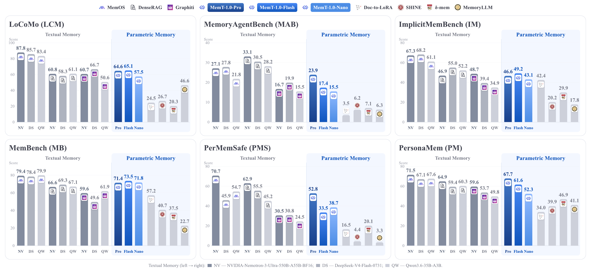

<div align="center">
  <picture>
    <source media="(prefers-color-scheme: dark)" srcset="assets/MemT-1.0.png">
    <source media="(prefers-color-scheme: light)" srcset="assets/MemT-1.0.png">
    
  </picture>

  <p align="center">
    <a href="https://huggingface.co/collections/MemTensor/memt-1"></a>
    <a href="https://modelscope.cn/models/MemTensor/MemT-1.0-Pro"></a>
    <a href="https://arxiv.org/abs/2610.26825">
      
    </a>
  </p>

  <p align="center">
    <strong>English</strong> | <a href="README_zh.md">简体中文</a>
  </p>
</div>

> 🚀🚀 **We are happy to announce the release of MemT-1.0-Pro [MemT × NVIDIA]!**

## **Overview**

**MemT-1.0 is a new generation of memory foundation models that makes persistent, dynamically evolving memory an intrinsic part of model computation.**

MemT-1.0 integrates dynamic local memory and trainable hyper memory to retain and leverage historical information without accessing original context at inference. Its persistent state remains constant in size, reducing storage by approximately 66× versus full-context KV cache at 128K history length.

The project makes three main contributions:

* **Memory architecture**. Introduce MemT-1.0 with improved memory storage and utilization, and Mixture-of-Storage (MoS) for scalable memory capacity.

* **Training and evaluation**. Develop backbone preparation and a two-stage training pipeline, supported by 34B tokens of data and dedicated infrastructure. Evaluate memory and general capabilities.

* **Scaling and applications**. Study memory scaling and demonstrate native memory for experience-guided agentic coding.

### Model Family

| Model                                                             | Backbone                   | Total Parameters | Activated Parameters | Trainable Memory Parameters | Dynamic Memory State |
| ----------------------------------------------------------------- | -------------------------- | ---------------- | -------------------- | --------------------------- | -------------------- |
| [MemT-1.0-Nano](https://huggingface.co/MemTensor/MemT-1.0-Nano)   | Qwen3.6-35B-A3B            | 36B              | 3B                   | 451M                        | 10M                  |
| [MemT-1.0-Flash](https://huggingface.co/MemTensor/MemT-1.0-Flash) | DeepSeek-V4-Flash          | 288B             | 17B                  | 3.61B                       | 336M                 |
| [MemT-1.0-Pro](https://huggingface.co/MemTensor/MemT-1.0-Pro)     | NVIDIA-Nemotron-3-Ultra-550B-A55B | 554B     | 59B                  | 4.23B                       | 13M                  |

### Architecture

A **Native Memory Block** runs alongside the backbone attention and contains two components:

* The **Local Memory Block** maintains a dynamic, multi-channel memory matrix and evolves across interaction steps.

* The **Hyper Memory Block** contains trainable memory query, key, and value projections, erase, write, and forget gates, as well as an output gate.

During generation, memory attention reads from the current memory state, normalizes and gates the readout, and adds it to the backbone attention output. At the end of each turn or segment, stable GDN-2 performs token-level memory updates for subsequent steps.


### Evaluation Results

Across 11 memory benchmarks, MemT-1.0-Pro, MemT-1.0-Flash, and MemT-1.0-Nano rank first, second, and third among the **evaluated parametric-memory methods**, respectively. Strong textual-memory systems remain ahead overall, particularly on long histories that require detailed evidence retrieval.



### Experience-Guided Agentic Coding

MemT-1.0 introduces an agentic framework for reusing procedural experience in long-horizon coding tasks. Retrieved experience is stored in native memory and accessed through memory attention during execution, improving task performance without adding experience text to the task context.


## **Quick Start**

The examples below serve MemT-1.0-Nano with SGLang and use the `memt_sglang` Python client for conversations with native memory. For deployment details and MemT-1.0-Flash / Pro setup, see the inference guide in [English](inference/README.md) or [简体中文](inference/README_zh.md).

### Installation

On a Linux server with NVIDIA CUDA and Python 3.11 or newer, install from the repository's `inference` directory:

```bash
cd inference
uv pip install '.[server]'
```

If the Python client runs in a separate environment, install the client extra from the same directory in that environment:

```bash
uv pip install '.[client]'
```

### Start the Server

Use a complete local MemT-1.0-Nano checkpoint with matching BF16 weights, configuration and tokenizer assets:

```bash
sh start_memt_nano.sh /models/MemT-1.0-Nano
```

This example uses two GPUs and serves at `http://127.0.0.1:30000`, with memory snapshots stored in `./memt-state` on the server. Keep the server running and run the Python examples below in another terminal. For Flash, use [start_memt_flash.sh](inference/start_memt_flash.sh) and the Flash client setup described in the [inference guide](inference/README.md#python-client).

### Connect the Client

Use local tokenizer assets matching the served checkpoint. The client loads the tokenizer; model inference runs on the SGLang server.

```python
import os
from transformers import AutoTokenizer
from memt_sglang.client import MemTSession, NativeClient, load_chat_format

model_path = "/models/MemT-1.0-Nano"
tokenizer = AutoTokenizer.from_pretrained(
    model_path,
    local_files_only=True,
    trust_remote_code=False,
)
# chat_format builds inputs; parser extracts reasoning and tool calls.
chat_format, parser = load_chat_format(
    model_path,
    tokenizer=tokenizer,
    chat_template_kwargs={"enable_thinking": False},
)
client = NativeClient(
    "http://127.0.0.1:30000",
    api_key=os.environ.get("MEMT_API_KEY"),
)
```

### A Conversation with Memory

Memory reading is enabled by default, so committed memory is used automatically. Set `enable_memory=True` to save unsaved past and current turns to latent local memory after the reply completes, then clear their plaintext conversation context. This also works on the first turn. Tool chains are saved after the final answer; truncated replies remain available for a later commit or save. `chat()` returns answer text by default. Use `return_dict=True` for a structured result. Responses shown below are illustrative.

```python
session = MemTSession(client, chat_format, parser)

answer = session.chat(
    "I have a three-month-old kitten named memmy who loves eating "
    "small shrimp and is excellent at remembering things."
)
print(answer)
# Memmy is three months old, loves small shrimp, and has an excellent memory.

# After replying, save the kitten-description and current game Q&As to latent
# local memory and clear their plaintext conversation context.
answer = session.chat(
    "What is a simple game I can play with my kitten?",
    enable_memory=True,
)
print(answer)
# Try gently moving a wand toy for your kitten to chase.

# Answer using the latent local memory of the kitten-description Q&A.
answer = session.chat(
    "What are my kitten's name, age, favorite food, and special trait?",
    enable_memory=True,
)
print(answer)
# Based on the information you provided earlier:
#
# *   **Name:** Memmy
# *   **Age:** Three months old
# *   **Favorite Food:** Small shrimp
# *   **Special Trait:** An excellent memory
```

### Save and Resume

`save_state(path)` commits remaining turns before saving. The returned `path` identifies the snapshot in the server's configured state directory; pass it as `state` when restoring a session.

```python
# Save local memory, including any unsaved conversation turns.
snapshot = session.save_state("memmy_memory.safetensors")
session.close()

# Restore memory without the previous conversation transcript.
with MemTSession(client, chat_format, parser, state=snapshot["path"]) as restored:
    print(len(restored.messages))
    # 0

    answer = restored.chat("How old is my kitten?")
    print(answer)
    # Your kitten is **3 months old**.
```

### Standard Chat

Create a fresh session without a snapshot and disable memory reading. Keep automatic history writes off with `enable_memory=False`; previous turns remain in the conversation transcript.

```python
with MemTSession(client, chat_format, parser) as chat:
    chat.set_memory_read(False)
    answer = chat.chat(
        "Type 'I love MemT' exactly.",
        enable_memory=False,
    )
    print(answer)
    # I love MemT
```

## **Citation**

For the MemT-1.0 technical report:

```bibtex
@misc{memtensor2026memt1,
  title         = {MemT-1.0: Towards Memory-Native Evolution},
  author        = {{MemTensor Team}},
  year          = {2026},
  eprint        = {2610.26825},
  archivePrefix = {arXiv},
  primaryClass  = {cs.CL},
  url           = {https://arxiv.org/abs/2610.26825}
}
```

## ⚖️ License

This project uses separate licenses for the paper and the repository software:

- **Paper:** The technical report and original paper materials are licensed under the [Creative Commons Attribution-NonCommercial-ShareAlike 4.0 International License](LICENSE-PAPER).
- **Repository software:** Original source code in this repository, including the SGLang integration, is licensed under the [PolyForm Noncommercial License 1.0.0](LICENSE).

Bundled third-party components retain their own licenses. The SGLang integration includes flash-linear-attention code under MIT; see the [component license table](inference/README.md#licensing).

Commercial use of the repository software is not permitted under the PolyForm Noncommercial License. For commercial licensing inquiries, please contact the authors.

Unless explicitly stated otherwise, model weights, datasets, benchmark assets, trademarks, and third-party materials are not covered by the licenses above. Their applicable terms will be provided with the corresponding releases.

## 📬 Contact

Research correspondence: [lizy@memtensor.cn](mailto:lizy@memtensor.cn).
